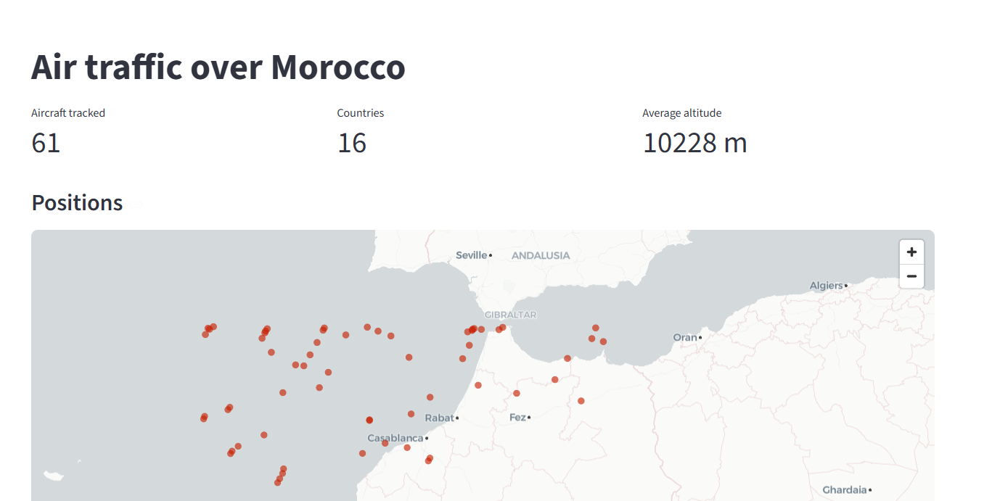
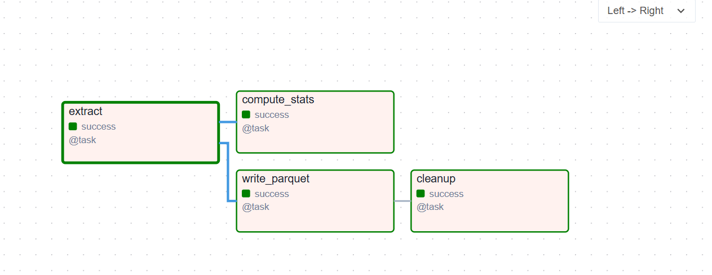

# Flight Tracker Pipeline

Pipeline de donnees en temps reel sur le trafic aerien au-dessus du Maroc.

[English version](README.en.md)

Les positions des avions sont collectees depuis l'API OpenSky Network,
publiees dans Kafka, stockees dans MongoDB, analysees en continu par
Spark Structured Streaming, visualisees dans un tableau de bord Streamlit,
et archivees chaque nuit en Parquet par un DAG Airflow.



## Architecture

```
                                    ┌──> Consumer ──> MongoDB ──> Dashboard
OpenSky API ──> Producer ──> Kafka ─┤                    │
                                    └──> Spark Streaming │──> Alertes
                                                         │
                                         Airflow (2h00) ─┴──> Parquet
```

| Composant | Role |
|---|---|
| Producer | Interroge l'API OpenSky toutes les 60 s, nettoie et valide les donnees, publie dans le topic `flight-positions` |
| Kafka | File de messages qui decouple la collecte des traitements |
| Consumer | Lit le topic et ecrit dans MongoDB |
| Spark Streaming | Analyse le meme flux en parallele et detecte urgences, approches et circuits d'attente |
| MongoDB | Stockage operationnel des positions (couche chaude) |
| Dashboard | Interface Streamlit : carte temps reel, indicateurs, vols en approche |
| Airflow | Orchestre l'archivage quotidien en Parquet et la purge de MongoDB |
| PostgreSQL | Base interne d'Airflow (metadonnees, historique des executions) |

Le decouplage par Kafka permet d'ajouter un consommateur sans jamais
modifier le producteur.

Le projet combine les deux regimes de traitement : du **streaming** pour
detecter et afficher en direct, du **batch** pour archiver, agreger et
nettoyer a heure fixe.

## Lancer le projet

Prerequis : Docker Desktop, et une horloge systeme synchronisee
(voir Pieges connus).

```bash
docker compose up -d --build
docker compose ps
```

Interfaces disponibles une fois la pile demarree :

| Service | Adresse | Identifiants |
|---|---|---|
| Tableau de bord | `http://localhost:8501` | aucun |
| Airflow | `http://localhost:8080` | `admin` / `admin` |

Suivre l'activite :

```bash
docker compose logs -f producer
docker compose logs -f consumer
docker compose logs -f spark
```

Arreter :

```bash
docker compose down
```

Les donnees sont conservees dans les volumes `mongo_data` et `pg_data`.

## Acceder aux donnees

MongoDB est expose sur l'hote sur le port 27018 (et non 27017, pour ne pas
entrer en conflit avec une instance locale) :

```
mongodb://localhost:27018
```

Base `flights`, collection `positions`.

Les archives Parquet sont ecrites dans `data/parquet/`, un fichier par jour :
`positions_AAAA-MM-JJ.parquet`.

## Cycle de vie de la donnee

| Donnee | Emplacement | Usage |
|---|---|---|
| 3 derniers jours | MongoDB | Dashboard, alertes, requetes en direct |
| Historique complet | Fichiers Parquet | Analyses sur plusieurs semaines |

La separation entre couche chaude et couche froide evite de laisser grossir
indefiniment la base operationnelle, tout en conservant l'historique dans un
format colonne compact.

## Tableau de bord

Interface Streamlit alimentee par MongoDB, affichant les 15 dernieres minutes
de trafic :

- Indicateurs : nombre d'avions suivis, pays representes, altitude moyenne
- Carte centree sur le Maroc, une position par avion, avec infobulle
  (indicatif, pays, altitude)
- Repartition par pays d'immatriculation
- Table des avions en approche ou au decollage
- Table complete des vols, triee par altitude

Pour le lancer seul, sans conteneur :

```bash
streamlit run src/dashboard/app.py
```

## Detections temps reel

| Alerte | Critere |
|---|---|
| `EMERGENCY` | Squawk 7500 (detournement), 7600 (panne radio) ou 7700 (urgence generale) |
| `LOW_AND_SLOW` | Altitude < 1500 m, vitesse < 400 km/h, avion en vol : approche ou decollage |
| `HOLDING_PATTERN` | Au moins 4 positions dans une fenetre de 10 min, sous 6000 m, avec un deplacement inferieur a 0,15 degre en latitude et longitude |

La detection de circuit d'attente utilise des fenetres glissantes de 10 min
(pas de 5 min) avec un watermark de 2 min.

## Orchestration



Le DAG `daily_archive` s'execute chaque nuit a 2h00 :

```
extract ──┬──> compute_stats
          │
          └──> write_parquet ──> cleanup
```

| Tache | Role |
|---|---|
| `extract` | Lit dans MongoDB les positions de la journee ecoulee |
| `write_parquet` | Ecrit ces positions dans `data/parquet/positions_<date>.parquet` |
| `compute_stats` | Calcule avions distincts, pays, altitude moyenne, top 5 des pays |
| `cleanup` | Supprime de MongoDB les positions de plus de 3 jours |

**L'ordre des taches est une decision de conception, pas une commodite.**
`cleanup` prend en entree le chemin produit par `write_parquet`, ce qui cree
une dependance explicite : Airflow ne purge jamais avant que l'archivage ait
reussi. Si l'archivage echoue, la purge ne se lance pas ; si le lot est vide,
elle s'annule d'elle-meme. Le raisonnement est le meme que pour les offsets
Kafka : entre deux ordres possibles, on retient celui dont l'echec est
reparable. Perdre de la place sur le disque se rattrape, perdre des donnees
non.

Chaque tache est configuree avec `retries: 2` et un delai de 5 minutes.

Execution du 16/10/2026 sur la journee du 15/10 :

| Tache | Resultat |
|---|---|
| `extract` | 5313 positions extraites |
| `write_parquet` | 5313 lignes ecrites dans `positions_2026-10-15.parquet` |
| `compute_stats` | altitude moyenne 10 657 m |
| `cleanup` | 873 documents supprimes |

L'egalite entre positions extraites et lignes ecrites est la verification qui
compte : aucune ligne perdue entre MongoDB et le fichier Parquet.

## Qualite des donnees

- Validation a l'entree : les positions sans latitude ou longitude sont rejetees
- Gestion des valeurs manquantes : l'API renvoie frequemment des champs vides
- Idempotence : un index unique sur `icao24` + `timestamp` empeche les doublons
- Conversion d'unites : la vitesse passe de m/s a km/h a l'ingestion
- Semantique at-least-once : les offsets Kafka sont valides apres ecriture en
  base et non avant, donc aucun message ne peut etre marque comme traite sans
  avoir ete enregistre. Les doublons eventuels sont absorbes par l'index unique.
- Archivage avant purge : aucune donnee n'est supprimee de MongoDB sans avoir
  ete ecrite en Parquet au prealable
- Tests unitaires sur la transformation des donnees brutes

## Resilience

Kafka decouple la collecte du stockage : si MongoDB devient indisponible,
les messages s'accumulent dans le topic au lieu d'etre perdus.

Test realise : MongoDB arrete pendant la collecte.

- Le producer a continue de publier sans interruption
- Le consumer a attendu le retour de la base avec un backoff exponentiel
  (1, 2, 4, 8, 16 s) au lieu de planter en boucle
- Au retour de la base, il a repris a son offset et rattrape l'integralite
  des messages : 452 messages consommes, retard de lecture revenu a 0,
  1400 positions en base, aucune perte

Au demarrage, le producer et le consumer attendent que Kafka passe son
healthcheck. `depends_on` seul ne suffit pas : il attend que le conteneur
demarre, pas que le broker accepte les connexions. Airflow attend de la meme
facon que PostgreSQL passe le sien.

Le dashboard affiche un message explicite si MongoDB est injoignable, au lieu
de remonter une trace Python.

## Validation

### Detection HOLDING_PATTERN

Script : `scripts/inject_holding.sh [icao24]` (defaut `test01`). Il injecte
dans `flight-positions` 5 positions d'un avion fictif quasi immobile pres de
Casablanca (ecart max 0,01 degre, environ 3000 m), une toutes les 2 minutes,
avec timestamp = heure d'envoi. Usage, resultat attendu et nettoyage Mongo
sont decrits en tete du script.

Resultat du 15/10/2026 :

| Fenetre (UTC) | Points | Sortie Spark |
|---|---|---|
| [14:15, 14:25) | 2 | aucune (< 4 positions) |
| [14:20, 14:30) | 5 | `HOLDING_PATTERN` test01, nb_positions=5, delta_lat=delta_lon=0,01, altitude_moy=3004 |
| [14:25, 14:35) | 3 | aucune (< 4 positions) |

Les fenetres voisines servent de controle negatif : elles verifient que le
seuil `nb_positions >= 4` filtre bien, et pas seulement que la detection
produit une sortie.

L'alerte est emise 2 a 3 min apres la fin de la fenetre, une fois le
watermark depasse. Les documents `test01` ont ete supprimes de
`flights.positions` apres le test.

L'injection de messages est la methode de validation retenue car les
evenements cibles sont rares en conditions reelles : un squawk d'urgence ou
un circuit d'attente suppose une situation anormale ou une saturation
d'aeroport.

## Pieges connus

**L'horloge de la machine doit etre juste.** Les timestamps injectes viennent
de l'horloge locale, ceux du trafic reel d'OpenSky. Avec une horloge Windows
en retard d'une heure, le watermark Spark, cale sur le trafic reel, se
retrouve une heure en avance : les messages injectes sont ecartes comme
tardifs, sans aucune erreur dans les logs. Le script verifie desormais
l'ecart avec OpenSky et s'arrete au-dela de 60 s.

La VM Docker peut deriver apres une mise en veille. Verifier avec
`docker run --rm alpine date -u` et resynchroniser par `wsl --shutdown`
suivi d'un redemarrage de Docker Desktop.

**Python bufferise ses sorties** quand il n'ecrit pas dans un terminal. Sans
`ENV PYTHONUNBUFFERED=1` dans l'image, `docker compose logs` reste vide meme
quand la pipeline fonctionne.

**Le cadrage automatique d'une carte suit les donnees.** Avec `st.map`, la
vue se recentrait sur l'Espagne des que le trafic se concentrait au nord de
la zone. Le dashboard fixe donc explicitement le centre et le zoom via
`pydeck`.

**Les logs d'anciennes tentatives Airflow peuvent etre perdus.** L'interface
les sert depuis le worker qui a execute la tache ; si ce conteneur a ete
recree, elle affiche une erreur `HTTPConnectionPool` a la place. Seule la
derniere tentative est consultable. En cas de doute, lire les fichiers
directement dans `/opt/airflow/logs`.

## Technologies

Python, Apache Kafka, Apache Spark (Structured Streaming), MongoDB,
Apache Airflow, PostgreSQL, Parquet, Streamlit, Docker Compose, pytest

## Tests

```bash
python -m pytest
```

## Structure du projet

```
src/
├── fetch_flights.py       collecte, transformation, validation
├── messaging/
│   ├── producer.py        publication dans Kafka
│   └── consumer.py        lecture Kafka et ecriture MongoDB
├── streaming/
│   └── spark_job.py       detections temps reel
├── dashboard/
│   └── app.py             interface Streamlit
└── storage/
    └── mongo.py           acces a la base

dags/
└── daily_archive.py       DAG Airflow : archivage et purge

docker/
├── collector.Dockerfile   image commune producer/consumer
├── spark.Dockerfile       image Spark avec connecteurs Kafka
├── dashboard.Dockerfile   image Streamlit
└── download_jars.sh       telechargement des connecteurs au build

scripts/
└── inject_holding.sh      injection de messages de test

tests/
└── test_parsing.py

data/parquet/              archives quotidiennes (ignore par Git)
```

## Limites connues

Le projet est teste sur la zone geographique du Maroc, soit quelques dizaines
d'avions simultanes. L'architecture est concue pour monter en charge mais n'a
pas ete eprouvee sur de gros volumes.

Le producer interroge l'API toutes les 60 s, ce qui limite a 10 positions par
avion et par fenetre de 10 minutes. Une frequence plus elevee affinerait les
detections mais consommerait davantage de credits API (400 par jour en acces
anonyme, 4000 avec un compte).

Le dashboard lit MongoDB a chaque rafraichissement manuel, sans mise a jour
automatique.

Airflow tourne en `LocalExecutor` avec des identifiants par defaut, adaptes a
un usage local uniquement. Un deploiement reel demanderait une gestion des
secrets et un executeur distribue.

## Etapes suivantes

- Mini entrepot de donnees en schema en etoile pour l'analyse historique
- Affichage des alertes Spark dans le dashboard
- Authentification OAuth2 OpenSky pour passer de 400 a 4000 credits par jour
